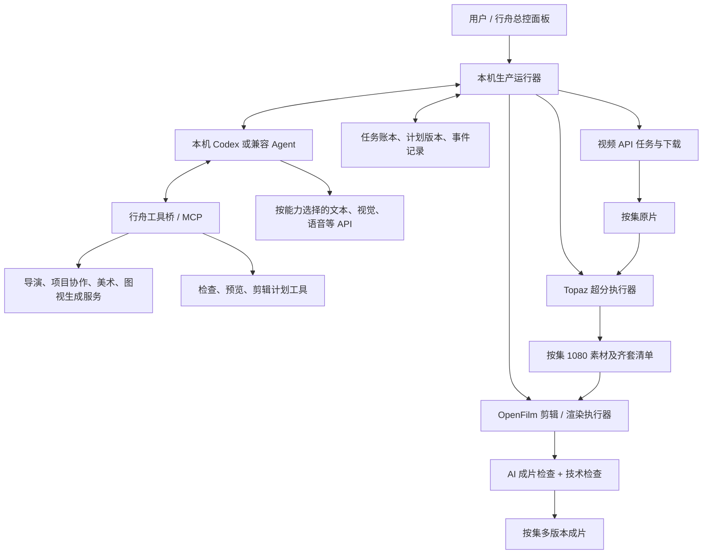

# 行舟影视 × 本机 Agent：自动化、半自动化与 AI 剪辑上层架构

日期：2026-10-20

状态：完整自动化仍为设计稿；用户已授权实施的前置关联模式见 `docs/release-verification-2.8.54-private.1.md`，本机试用包已完成。
范围：先供拥有者这一台 Windows 电脑试用；用户另行明确同意后，才向其他用户开放。

## 1. 本方案以什么需求为准

最关键的产品定义：**用户先连接本机 Codex 或兼容 Agent，让 Agent 与行舟影视联动完成制作。** 不能把“本机 Agent”缩减成一个文本 API 选项，也不能把半自动化做成单纯自动点击。

用户已明确：

1. 全自动：导入剧本，完成分段、提示词、美术清单与核实、图片生成、逐条素材关联、视频生成、下载归档、Topaz 超分、逐集 AI 剪辑、多版本导出。
2. 半自动：用户做好提示词和美术，并核对每条提示词的素材与参数，移交后自动生成、下载、检查、超分、剪辑、导出；后半程同样必须有 AI 参与。
3. 生成前的关联粒度是“项目—集—场—提示词条目”；视频原片、超分素材按集归档，成片也是一集一个作品。
4. 每集超分素材全部就绪后即可剪辑，不等全剧全部生成完。剪辑按集排队，第一集剪完接下一集。
5. 启动前有总控设置，包含 Agent、模型/API、素材、音乐、字幕、尾帧、超分、导出版本等。
6. 优先使用用户准备的约 10～20 首音乐；也可以让 AI 找音乐。配乐按情绪变化，合适位置淡出、切换，避免整集机械循环同一首。
7. 需要复用用户在剪映中的尾帧范式；具体剪法和进一步规则后续继续补充。
8. 本机已有 OpenFilm 和 Topaz，希望与行舟影视、Codex 联动。
9. **不确定的素材关联允许 AI 在限定次数内修正，仍不确定再暂停。** 这是本轮用户已作出的选择。
10. 将来其他用户使用这些功能，也需要在自己的电脑上安装并连接 Codex 或兼容 Agent。

以下为方案建议，尚不代表用户已选定：默认修正次数、预算数额、并发数、具体剪辑节奏、音乐淡入淡出秒数、字体、尾帧时长、超分模型，以及最终发布渠道。本稿给出可执行的边界和设置位置，不擅自认定这些审美参数。

## 2. 可行性结论与质量边界

工程链路可实现，现有行舟影视已经具备较多前置能力。真正新增的核心是：**Agent 联动桥、持久化生产调度器、条目级素材决策、逐集交付契约、超分与剪辑适配器。**

可以用工程规则严格保证：条目身份不混淆、已选素材顺序不乱、参数符合模型能力、缺片不进入剪辑、下载失败不冒充完成、恢复时不盲目重复付费、每个成片可追溯到输入。

不能承诺任意剧本、任意模型都能达到“画面内容永远正确、零人工介入”。图像/视频生成及 AI 画面判断都可能出错。全自动的准确含义是：正常路径无人干预，异常自动检查和有限修正，仍未达标就保留现场并暂停受影响任务。不能为了显示完成而放行错误素材。

本方案覆盖到成片导出。社交平台上传、账号登录和公开发布另接发布模块，不因“导出完成”自动发布作品。

## 3. 已读现有工作流及本机证据

### 3.1 代码基线

本轮读取的软件源码为 `tencent/`，`package.json` 版本 2.8.53，HEAD `125778d`；本地发布记忆也记载 2.8.53。本轮没有重新核验线上发布状态，也没有核定当前正在运行的行舟安装实例版本。

工作树原有其他修改及未跟踪文件；本方案不改动它们。不调用生成 API，不改变真实项目。

| 现有环节 | 已核实的代码行为 | 自动化接入设计 |
|---|---|---|
| 导演上传、分集分场 | `src/v06/DirectorWorkspace.jsx`、`core/scriptImport.js` | 复用解析，保留原始正文、集身份和场身份 |
| 按最高时长拆提示词 | `core/directorSegmentation.js`、`directorDurationPolicy.js` | 复用分段与时长约束，由 Agent 检查覆盖和表演完整性 |
| 全剧批量生成提示词 | `core/directorBatchGeneration.js`，已有场景事务和检查点 | 加入生产计划；不能把“有旧提示词所以跳过”当成完整性证明 |
| 美术连续分析与核实 | `core/artContinuousAnalysis.js`、`artReviewBatch.js`、`src/v06/ArtWorkflowControl.jsx` | 接入 AI 检查与修正；AI 核实和人工核实分别记录 |
| 美术出图、基准与妆造 | `core/artImageBatch.js`、`collabStore.js`、`assetImageRecovery.js` | 复用资产依赖和原任务恢复，先基准后依赖图 |
| 按场导出图片 | `electron/image-export.cjs` | 已支持按集、场导出；新增机器可读清单保留资产和图片身份 |
| 整本提示词导入 | `core/promptBook.js`、`src/v06/PromptBookWorkspace.jsx` | 已解析【集-场-条】、区分重复编号；新增稳定条目 ID |
| 场共享、逐条排除 | `bookSharedReferences`、`entryValue`、`saveEntryValue` | 尊重每条的排除、追加素材及单条参数 |
| 自动匹配参考素材 | `core/automaticReferences.js` | 已有基础设定字段匹配、引用编号重排、人工排除记忆；还需 AI 精细裁选 |
| 视频提交与取回 | `electron/generation-jobs.cjs`、`video-provider.cjs` | 复用提交/查询/下载，外加生产任务身份和防重机制 |
| 自动刷新 | `src/v06/GenerationMonitor.jsx` | 当前 React 监视器约每 30 秒检查；新后台应接管相关任务，避免两处竞相处理 |
| 本机 Codex | `electron/codex-local.cjs`、`text-provider.cjs` | 当前是纯文本处理入口，另增 Agent 工具联动模式，不能称现已完整支持 |

**现有素材匹配的具体缺口：** `matchBasicReferences` 从已挂载的 references 开始匹配，可以添加引用并重排别名，但不会自动把场景共享素材中每一个与当前片段无关的项全部删去。因此用户现在逐条排除素材的工作确实仍需要新的决策层。

**现有本机 Codex 的具体边界：** 当前实现运行 `codex exec`，要求纯文本输出、不调用工具、不读写文件，工作目录是临时目录；支持 ChatGPT 登录检查。它适合文字处理，但不是本方案需要的可调度行舟、Topaz、OpenFilm 的 Agent 联动。

另有兼容约束：`core/skillExecution.js` 对自带受保护导演 Skill 有服务端线路限制，当前不能直接交给 codexLocal。本方案保持该边界：Agent 调用行舟的“执行导演步骤”工具，由软件沿原有允许线路执行；Agent 读取合法结果。新增本地剪辑规则与开放工作流 Skill 可以由 Agent 使用，不复制受保护正文到本地插件。

### 3.2 本机只读核查

| 软件/硬件 | 已核实 | 仍需实际样片验收 |
|---|---|---|
| OpenFilm | 注册表版本 0.2.1，安装目录 `D:/openfilm`，有内置运行资源 | 当前安装版与联动适配器的兼容性、长集渲染速度、中文字体和音画同步 |
| OpenFilm 源码副本 | `C:/Users/11599/Documents/ChatGPT/剪辑工作/openfilm`，提交 `eefd6a8`，核心包声明 0.2.0 | 源码副本不能视作安装版 0.2.1 的同一制品 |
| Topaz Video | 注册表版本 1.1.2，`D:/Topaz Video` | 登录/许可、模型就绪、实际超分画质、速度与显存占用 |
| Topaz 命令行 | 本机 `ffmpeg.exe -filters` 有 `tvai_up`；帮助含 scale、w、h、device 参数；有 ffprobe | 本轮仅查看帮助，没有启动超分或下载模型 |
| Codex | 本机 CLI 版本 `0.163.0-alpha.10.2`，帮助含非交互执行及输出 schema | 当前登录、额度、模型和 app-server 工具闭环需实施时检查 |
| 剪映 | 注册表版本 11.6.0.14552 | 用户尾帧工程可否读取、效果能否移植 |
| GPU | NVIDIA GeForce RTX 5060 Laptop GPU | 可用显存、持续负载、性能；不依据型号推断并发和时长 |

## 4. 三条架构路线及推荐

| 路线 | 优点 | 局限 | 结论 |
|---|---|---|---|
| Codex 通过屏幕逐个点击软件 | 快速验证个别入口 | 窗口遮挡、弹窗、改版、锁屏会干扰；任务恢复和费用去重困难 | 仅保留无接口软件的局部后备操作 |
| 行舟只调用文本/视觉 API，自行跑固定流程 | 集成简单 | 没有用户所要求的外部 Agent 联动和工具执行闭环 | 不作为本项目主路线 |
| **本机 Agent + 行舟工具桥 + 后台调度器 + 专用执行器** | Agent 真正参与判断和调用；后台稳定执行和恢复；可适配其他 Agent | 需要新增接口、状态持久化和能力验收 | **推荐** |

推荐路线中 Agent 与调度器各有职责。Agent 决定“用哪些素材、如何修正、怎么剪”；调度器保证“何时执行、是否已执行、是否完成、下一步能否启动”。AI 不必每几秒重新思考一次下载状态。

## 5. 总体结构与 Agent 联动方式



### 5.1 用户看到的联动

1. 打开行舟的自动化总控，选择“连接本机 Codex”或另一种已支持 Agent。
2. 检查安装、登录、工具连接、模型能力和项目权限，显示“已连接 / 待登录 / 缺能力”。
3. 为本次剧目建立独立的制作上下文，加载剧本、已确认规则、选定 Skill、输出目录和预算。
4. 用户开始任务后，Agent 通过行舟工具获取项目、提交决策、启动已授权阶段、读取结果、有限修正。
5. 面板展示当前 Agent 在处理什么、对应证据、下一步及待人工处理项。用户可暂停、改规则、锁定素材。
6. 下次打开软件，由任务账本恢复；不要求用户重新把全部背景贴一遍。

### 5.2 两个方向的桥接

**Agent → 行舟：MCP 工具桥。** 将行舟已有能力整理成稳定工具，Codex 和其他符合要求的 Agent 可以读取项目、调用工作流及查询结果。MCP 是工具协议，Skill 是使用这些工具的方法，两者都需要。

**行舟 → Agent：Agent 会话适配器。** 后台出现“某集已齐套”“检查失败可修正”等事件后，运行器恢复对应 Agent 会话并发起下一轮。只有 MCP 工具暴露并不足以保证无人值守运行，必须有此唤醒入口。

Codex 优先评估官方 app-server 的 stdio 通道，管理初始化、会话、轮次和事件；实施时按本机版本生成/核对协议。后备方式是受控 CLI 轮次执行并保存结果，但必须验证工具调用、恢复和取消能力，不能直接套用现有“禁止工具的纯文本”模式。官方资料支持 app-server 的会话与事件交互，以及非交互模式的结构化输出。[Codex App Server](https://learn.chatgpt.com/docs/app-server)、[非交互模式](https://learn.chatgpt.com/docs/non-interactive-mode)。

这里连接的是本机可调用的 Agent 运行时，不宣称能够直接接管正在聊天的 Codex 桌面窗口，也不依赖当前聊天永远打开。是否在 Codex 桌面同步显示制作会话，需要另验具体集成能力。

### 5.3 兼容其他 Agent 的门槛

至少具备：工具调用、结构化结果、长任务状态读取、非交互启动或事件唤醒、取消、会话恢复或上下文重建。仅有聊天 API Key 不算已连接 Agent。

Agent 可以把视觉、语音、图片和视频工作交给专业 API；不要求一个模型包办所有模态。未来用户必须连接合格 Agent 后才能启动自动化；没有连接仍可使用原有手动功能。

### 5.4 拟提供的行舟工具

下列名称是设计契约，并非当前已有接口：

| 工具组 | 典型能力 | 执行约束 |
|---|---|---|
| 项目与计划 | `project_snapshot`、`production_plan_read` | 返回本次项目和版本；内容与指令分离 |
| 导演与美术 | `director_prepare`、`art_analyze`、`art_generate` | 复用现有权限和 Skill 线路，返回任务句柄 |
| 素材绑定 | `binding_candidates`、`binding_propose`、`binding_validate` | 图片身份、版本、排除项、顺序可查；不越过人工锁定 |
| 生产执行 | `clip_submit`、`task_status`、`task_events` | 先落盘再提交；重复调用返回同一逻辑任务 |
| 视频检查 | `media_probe`、`media_evidence`、`clip_review` | 返回尺寸、时长、抽帧/音频证据和检查结论 |
| 超分 | `upscale_enqueue`、`upscale_status` | 固定候选预设；不接受无限制命令字符串 |
| 剪辑 | `edit_plan_propose`、`edit_plan_validate`、`edit_render` | 时间线通过规则校验后才能执行 |
| 交付与控制 | `episode_outputs`、`run_pause`、`run_resume`、`needs_review` | 明确版本、文件、原因；暂停不等于取消上游付费任务 |

长任务立即返回 `taskId`；Agent 不一直占用一次模型调用等待视频或超分完成。进度事件由运行器收集，再在需要判断时唤醒 Agent。

工具端做权限、预算、路径和状态检查，不能只依靠提示词提醒。一次运行只有一个活动决策者，避免两个 Agent 同时改同一集。

## 6. 两种模式共用一条生产流水线

### 6.1 全自动的前半段

剧本导入 → 集场解析 → 全剧背景与人物一致性基准 → 按模型时长分段 → 提示词与覆盖检查 → 美术清单 → 核实期间建立逐条提示词与卡片关联 → AI 核实/修正 → 基准形象及依赖妆造出图 → 图片检查及具体选图 → 按已存关系编译引用 → 参数预检 → 冻结本集生成计划。

提示词和美术可以在共同的剧本版本、背景与资产身份基准上并行准备；已有提示词的场在清单核实阶段提前汇合，尚无提示词的场保留等待关联状态。依赖同一人物基准的图不能随意并行独立设计。关联按场增量建立，不等待全剧完成。

每集只有分段完成、提示词覆盖完整、所需资产可用，才封存该集条目清单。不能前两条刚生成就把“目前有两条”当成本集全部数量。

### 6.2 半自动的移交

用户在现有页面完成提示词、美术和逐条核对 → 点击“移交半自动化” → 保存尚未落盘的编辑 → 复制当前条目的实际生效配置 → 预检 → 建立人工确认快照 → 后半段开始。

快照包括：文本版本、实际素材及顺序、明确排除项、模型、比例、时长、分辨率。不能重新用“场景全部素材”覆盖用户逐条核好的选择。

Agent 仍检查提交兼容性和后续质量。人工锁定项若出现疑问，AI 可以提出修正，但不能静默改掉；未锁定项按授权有限修正。进入后半段后同样有视频检查、超分检查、剪辑决策和成片检查。

### 6.3 共用后半段

视频提交 → 查询原任务 → 下载原片 → 技术/内容检查 → Topaz 超分 → 超分检查 → 本集全部条目齐套 → Agent 生成剪辑计划 → 校验 → OpenFilm 渲染 → AI 成片检查 → 多版本导出。

原片可逐条完成就逐条超分，以缩短等待；**剪辑必须等本集全部合格超分素材齐套**。后台可以同时生成第二集、超分第三集某些素材、剪第一集，但同一台电脑的重负载按资源队列控制。

## 7. 最重要的新增能力：逐条素材关联

本轮后续专项调查已补充：[视频生成前素材关联：现状复现、GitHub 调研与改进方案](2026-10-20-reference-binding-research.md)。用户进一步明确：美术核实正常时同场候选通常齐全，主要是逐条排除多余素材和补准 `@`。实测发现导出导入丢失类别/资产身份、横线前缀错绑、多人格式漏识别、多妆造同时绑定、旧错误引用保留等路径。必须把“候选集合、本条选用集合、引用映射”分开；P0 关联预检在自动化首次付费提交前完成，具体方案以专项文档为补充。

### 7.1 数据身份

用户追加的优先方案是“生图前把已有提示词关联到美术卡片”，详见[提示词与美术卡片提前关联：可选新模式设计](2026-10-20-prompt-art-prebinding-design.md)。保留旧模式，新模式先独立本机试用；不改写已有导演提示词。先确认 `promptId → cardUid`，发布后连接 `assetId`，出图后选定 `imageId`，最后才编译 `@`。卡片可跨条复用，不因多条使用而重复生图。

身份链为：

`projectId → episodeId → sceneId → entryId → bindingRevision → generationAttempt → artifactId`

集号、场号和文件名用于展示和排序，不代替稳定 ID。同样叫“客厅”的两集场景、同一角色的多套妆造，以及重复的【1-1-1】编号，都必须能区分。资产绑定至少保留 `assetId + imageId + revision + contentHash`。

### 7.2 从候选到可提交

1. 限定本项目、本集、本场候选，并尊重已经核实的关联；确需跨场复用的资产必须有明确身份和理由。
2. Agent 结合本条提示词、原场内容和前后条，列出实际入镜人物、形象状态、空间、道具。
3. 区分“画面出现”“仅被对白提及”“画外音”“回忆/想象”“禁止出现”；不能看见一个名字就绑定。
4. 对候选给出“保留 / 排除 / 缺失 / 不确定”及原文证据。核对衣服、年龄、伤势、昼夜、道具状态、具体图片。
5. 能力合格的视觉模型检查图片本身是否符合标签；缺视觉能力时不得伪称已看图。
6. 对照模型参考图数量和参考类型上限，必要时提出合图或更换适配方案；合图要另检查身份与布局，不能默默丢图。
7. 封存素材顺序，再编译 `@image1` 等引用别名，验证文本别名和最终实际请求一致。
8. 保存决策记录；只有通过规则与 AI 检查的当前版本能提交。

例：某场有甲、乙、丙、客厅、信封五类素材。第一条三人同框递信，可能用全套；第二条只是甲看信的特写，通常不需要乙、丙；第三条乙在画外说话，不因此添加乙的画面参考；第四条丙离开，只保留实际需要的角色和环境。具体取舍仍由当前镜头内容决定。

### 7.3 有限修正与人工接管

用户已同意有限修正。建议启动预设为“初次判断后最多再修正 2 轮”，该次数可改，尚待用户最终审定。每轮必须针对具体错误和证据，不允许无变化地反复尝试。

配额分开设置：关联/文本修正轮数、图片重生成次数、视频重生成次数、整集剪辑返修次数，以及金额上限。允许修正不等于无限付费重生成。未设置自动重生成预算时，只自动修正决策，不自动产生新的付费媒体尝试。

仍有缺失、互相矛盾、不能验证或达到预算时，暂停当前条目及依赖它的剪辑；其他独立任务继续。Agent 的自报置信度只是辅助信息，不能作为唯一放行条件。

## 8. 计划、账本与每集齐套判定

建议以本机 SQLite 保存新增生产账本，媒体保留在文件系统；现有业务数据继续由原服务管理，不迁移或另建一套冲突业务源。进程内队列只负责并发，不负责持久性。

核心记录：

| 对象 | 必备内容 |
|---|---|
| ProductionRun | 项目、账号、本机、Agent 适配器、规则版本、启动配置、预算、运行状态 |
| EpisodePlan | 稳定集 ID、展示集号、计划修订、封存时间、必须完成的有序 entryId 列表 |
| ClipTask | 提示词与素材快照、模型能力快照、时长、逻辑任务 ID、尝试次数、状态 |
| Artifact | 原片/超分片/成片角色、路径、哈希、尺寸、时长、帧率、音轨、验证状态 |
| AgentDecision | 决策输入哈希、Agent/模型、Skill 版本、证据、结果、修正记录 |
| EditPlan | 源片版本、时间线、台词、音乐、字幕、尾帧、导出配方、人工锁定 |
| Event / Lease | 状态变化、待发送事件、消费记录、执行租约和超时 |

**一集齐套条件：**

`当前封存计划中每个 entryId，都有且只有一个被选为当前有效版本的合格超分片，且文件检查通过、输入版本一致、必需检查通过、无未解决阻断项。`

不能只比较数量。五个文件可能包括同一条的两次生成，另一条实际上缺失；旧版文件、半截下载、临时文件都不能计入。

齐套后事务记录 `episode.ready_for_edit`；事件可重复投递，但 `(runId, episodeId, planRevision, editPolicyHash)` 对应的剪辑任务只能创建一次。文件夹监视只用于发现变化，最终是否可剪由账本和清单决定。

每个条目可有多次尝试，但交付素材目录只放本次选中的一条有效视频；其他尝试留在工作记录区。改变选择后产生新版本，旧成片标为待更新，不被无声覆盖。

## 9. 后台任务与故障恢复

条目主要状态：

`planned → binding_review → ready → submitting → remote_pending → downloading → source_check → upscale_pending → upscaling → upscale_check → ready_for_edit`

旁路状态包括 `retry_wait`、`submission_uncertain`、`needs_review`、`paused`、`superseded`。成片另有 `edit_planning → plan_check → rendering → output_check → delivered`。

关键约束：

- **防重复付费：** 提交前落盘逻辑任务和请求指纹；同一逻辑提交复用幂等键。接到远程任务 ID 后保存。请求结果未知时先查询原任务，不能直接重发。供应商没有去重/查询保障时，未知提交进入待核实，不能声称跨网络绝对 exactly-once。
- **查询与重生成分开：** 超时、429、临时网络问题按退避和供应商要求查询；下载失败只取回原结果。确认失败后是否重新付费由重生成预算决定。
- **轮询：** 建议本地事件即时处理，远程初始约 15～30 秒检查并退避，尊重 `nextPollAt`、Retry-After 和供应商限流；不让所有任务几秒一次集中轰炸接口。
- **原子落盘：** 下载、超分、渲染写入临时文件；成功退出、媒体可解码且检查通过后，才改成正式文件并提交账本。进程退出码 0 不是唯一成功标准。
- **崩溃恢复：** 租约到期后重新核对远端状态和本地文件，再决定恢复；不按“上次 running”直接重跑收费步骤。
- **版本失效：** 修改提示词只使依赖该提示词的产物失效；换音乐通常只重做相关剪辑/导出；换字幕只重做受影响版本，避免重生成全部视频。
- **暂停：** 停止接受新任务，尽量收回已运行结果；取消本地任务不承诺取消供应商收费。全局停止可终止本地子进程树，但保留可恢复记录。
- **关窗与重启：** 提议使用单独的本机生产运行器。关面板可继续运行；彻底退出运行器则暂停，重启恢复。休眠/关机时本机不会继续超分或剪辑；远端任务可能仍执行。
- **账号切换：** 未完成任务固定绑定原账号和运行配置，切号不拿新账号凭据查询旧任务。
- **资源调度：** 初始建议 Topaz 1 路、剪辑渲染 1 路，共享重 GPU 任务槽；视觉推理也纳入显存预算。实际并发用样片测定。
- **按集优先：** 生成和超分优先补齐最早未完成集。剪辑默认按集号串行；若前集需人工处理，后集生成/超分继续，剪辑是否越过前集作为总控选项，默认不越过。

## 10. 用户可直接使用的文件目录

建议用户选择一个制作根目录，在其下并列放原片、超分、成片和工作记录。示意中的“剧名”由真实剧本名称替换：

```text
制作根目录/
  原始视频/
    剧名/
      第001集/
        0001_1-1-1.mp4
        0002_1-1-2.mp4
        0003_1-2-1.mp4
      第002集/
        ...
  超分素材/
    剧名/
      第001集/
        0001_1-1-1.mp4
        0002_1-1-2.mp4
        0003_1-2-1.mp4
      第002集/
        ...
  成片/
    剧名/
      第001集_标准版.mp4
      第001集_无字幕版.mp4
      第001集_无配乐版.mp4
      第002集_标准版.mp4
      ...
  工作记录/
    剧名_项目短ID/
      production.sqlite
      运行批次/
        run-短ID/
          计划/
          素材关联/
          第001集/
            episode-manifest.json
            edit-plan.json
            film.html
            captions.srt
            证据与检查/
          尝试与历史版本/
          临时文件/
  美术资料/
    剧名/
      第001集/
        场景1-1/
        场景1-2/
```

对用户而言，原片和超分的剧名文件夹下面直接是各集，集内直接是按播放顺序排列的片段，不再套场景文件夹。场身份留在文件名及清单内。成片另有独立剧名文件夹。

文件名首段按数字补零，防止第 10 条排到第 2 条前。实际顺序以清单为准，不靠目录名称猜。不同项目同名、重复运行和历史尝试不得互相覆盖；冲突时加项目短 ID 或运行批次后缀并在面板解释。

## 11. Topaz 超分子系统

### 11.1 正确表达“超到 1080”

总控设置首先确定横竖画幅：

- 竖屏 9:16：1080×1920。
- 横屏 16:9：1920×1080。
- 其他比例：保存用户选定目标画布，并明确缩放、留边或裁切规则；不擅自拉伸或裁掉画面。

用户提到的“480 用 4 倍、720 用 2 倍”可保留为质量预设，但它与最终 1080 是两个参数。以横屏高度为例，480×4=1920，720×2=1440；都需要在增强后再归一到 1080。竖屏则要按真实宽高计算。

建议保留两种模式：

| 模式 | 处理 | 选择依据 |
|---|---|---|
| 直接目标尺寸 | 按真实源尺寸增强至目标画布 | 计算量通常更可控，具体模型效果需样片确认 |
| 按用户倍率增强后归一 | 480 档先 4×、720 档先 2×，再高质量缩回目标画布 | 尊重用户拟定方式；是否更清晰需要实测，不预设一定更好 |

启动时显示最终宽高；进入剪辑前也按最终宽高验收。源片已达到目标尺寸时，是否仅增强或直接合格入库由预设决定。

### 11.2 执行与检查

适配器优先调用本机 Topaz 自带 ffmpeg，使用在 GUI 中调好并导出的命令/预设，保存版本和哈希。AI 根据低分辨率样本提出候选预设，由白名单参数编译，不让模型随意拼接任意 shell 命令。

本机帮助已证实有超分滤镜；官方文档也说明 CLI 与 ffmpeg 的使用方式。文档路径和版本有差异，最终以安装版实际帮助及样片验证为准。[Topaz CLI 文档](https://docs.topazlabs.com/video-ai/advanced-functions-in-topaz-video-ai/command-line-interface)。

检查内容：目标尺寸、完整可解码、帧率、音轨、时长、帧数/时间戳一致性、颜色标签；再由视觉检查观察脸部、衣纹、道具文字等是否被过度锐化或扭曲。默认不因超分额外补帧、变速或截断对白。检查失败不能写入“合格超分素材”集合。

超分检查依旧不可能证明每帧语义绝对正确。保存抽检范围，重大疑点送人工，不把抽帧覆盖说成全帧验证。

## 12. AI 剪辑作为可独立演进的子项目

剪辑模块有独立输入/输出契约和版本；未来增加用户规则只影响这个模块，不需要重建导演、生成或超分。

**输入包：** 当前集齐套清单、超分素材、剧本与台词、镜头顺序、角色/场景身份、素材实际音轨、音乐库、字幕样式、尾帧模板、导出配方、项目风格、人工锁定内容。

**输出包：** 可读的剪辑决定、结构化时间线、OpenFilm 工程、字幕文件、标准和所选变体成片、质量报告、来源与版本记录。

### 12.1 AI 真正参与哪些决定

| 判断工作 | AI 输入 | 可执行输出 |
|---|---|---|
| 理解本集 | 剧本、台词、场景与前后情节 | 情绪段、叙事节点、必须保留内容 |
| 检查实际视频 | 抽帧/视频、音频、转写 | 人物和动作疑点、可用范围、对白缺失或多余 |
| 决定剪点 | 实际素材、叙事节点、用户规则 | 每段入点/出点、顺序、转场及理由 |
| 配乐 | 情绪段、音乐特征、对白时间 | 曲目、入点/出点、淡入淡出、对白压低包络 |
| 字幕 | 实际声音、剧本文字、人名词表 | 校订后的逐句文本、时间、断句、样式 |
| 尾帧 | 最后可用镜头、钩子规则、模板 | 定格点、持续时长、叠加层、音效 |
| 成片检查 | 渲染结果、源剧本与规则 | 通过、可自动修正的问题、需人工处理的问题 |

同一个 Agent 可以承担这些角色，无须先搭一群互相聊天的 Agent。视觉/语音能力不足时，由它调用专业模型工具，再把证据合并进决策。

API 选择按能力而不是按名称：文本模型可以规划，不能据此认定它看过视频；视觉模型要支持实际提供的输入；语音服务负责转写/对齐，画面 OCR 不代替听取对白。调用路线、费用和失败情况都可追踪。

### 12.2 时间线与剧情保护

剪辑计划每段至少保存：

`entryId, artifactHash, sourceIn, sourceOut, timelineStart, speed, dialogueSpanIds, reason`

内部用帧或有理数时间表示剪点，导出到 OpenFilm 秒数时统一转换，避免长集逐段累计误差。校验不超出源片、不出现非预期空洞、对白不截断、不重复遗漏必要剧情。

默认保持原剧情顺序和必需对白。可按规则裁去生成废帧、空白和无效停顿；涉及删情节、换顺序、重写台词时，必须符合用户预先给定的编辑权限。没有声音的生成片不能冒充有完整对白，应进入补配音流程或暂停。

先生成低成本预览和剪辑计划检查，再输出正式版本。预览不是人为逐步确认的强制关卡：全自动可由 AI 和规则放行，疑点才停。

### 12.3 音乐库与情绪配乐

总控三种来源：用户音乐库、已配置曲库检索、二者结合。生成音乐服务作为另外可选来源，需要对应接口与预算。不能把“自动找音乐”实现成无来源地下载任意歌曲。

每首音乐记录文件哈希、名称、来源、可用凭据/说明、时长、情绪、能量、节奏、是否有人声、适用情节、可用片段。AI 自动建议标签，用户可更正。曲库连接器尚未确定时明确显示缺能力，不能后台假装已经能联网取歌。

配乐过程：本集情绪分段 → 搜索合适音乐片段 → 选择转换点 → 生成淡入淡出与混音包络 → 听检对白清晰度及情绪变化。优先在情绪/叙事转折处切换，避免机械每 N 秒换歌，也不强制极短单情绪片段至少使用两首。

保留环境音和对白，背景音乐在对白期间降低，不盖住台词。跨集可复用主题动机，但避免连续机械重复。淡出、交叉淡化和响度技术执行可使用 FFmpeg 的相关滤镜；具体秒数及响度目标由用户预设和样片调定。[FFmpeg 滤镜文档](https://ffmpeg.org/ffmpeg-filters.html)。

### 12.4 字幕

总控统一字体文件、字号、描边、阴影、颜色、位置、安全区、行数、语言与断句规则，并提供预览。字体不可用时阻止正式交付或要求选择替代，不静默换成另一种效果。

字幕从**实际对白音频**取得时间，再用剧本校准人名、专有词和标点。剧本写了却未说出的台词应报缺失，不能直接贴字幕掩盖漏词。顺序、删改和变速发生后重新映射时间戳。

原视频已经烧录字幕时，“无字幕版”无法靠关闭字幕轨道还原，必须在生成源片阶段约束无烧录字幕并检查；不满足时提示该输出规格不可无损实现。

### 12.5 剪映尾帧模板

按范式选择三种交接方式：

1. **固定成品片尾：** 从剪映导出一段干净片尾视频，作为可复用素材；适用于每集完全相同的片尾。
2. **随本集最后画面变化的定格尾帧：** 提供文字、透明图层/图像、音效和时间关系，在 OpenFilm 中重建。仅一段已合成视频无法让底下的冻结画面随每集变化。
3. **剪映草稿转换：** 用户提供可读取的工程与依赖素材，经过版本验证后提取样式及轨道。不能承诺所有特效、字体、复合片段都无损转换。

尾帧预设记录 freezeSource、freezeAt、holdDuration、overlay、textTemplate、audioTail。AI 可选择符合规则的最后清晰帧，但不可把角色闭眼、转场黑帧误作默认尾帧。

公开 pyJianYingDraft 文档提示新版草稿读取和自动导出受版本限制；本机剪映 11.6 不能直接认定兼容。因此主路线采用 OpenFilm 交付，剪映主要提供样式来源或可选工程互通。[pyJianYingDraft 文档](https://github.com/GuanYixuan/pyJianYingDraft)。

### 12.6 多版本输出必须从分层工程产生

同一个已确认时间线生成多份配方：

| 版本 | 字幕轨 | 新增背景音乐轨 | 对白/环境/音效 |
|---|---|---|---|
| 标准版 | 开 | 开 | 保留 |
| 无字幕版 | 关 | 开 | 保留 |
| 无配乐版 | 按用户设置 | 关 | 保留 |
| 无字幕且无配乐版 | 关 | 关 | 保留 |
| 工程/字幕/音轨文件 | 按选择导出 | 独立保存 | 可追溯 |

“无音乐”须明确是无新增 BGM 还是没有任何音乐。若视频原音已经混入音乐，关闭后加音乐轨仍有原音乐；因此上游优先生成干净对白/环境声，或取得分离音轨。AI 分离属于可能有损的补救，不能承诺完美。

所有用户勾选的必需版本检查通过后，这一集才标为交付完成。某版本失败只重做该版本，不重生成视频和超分。第一集必需输出完成后释放剪辑队列供第二集使用；后一集生成与超分不受此等待限制。

### 12.7 OpenFilm 适配边界

OpenFilm 用 `film.html` 表示时间线，支持视频、音频和页面内容及渲染；适合输出可人工继续编辑的工程。[OpenFilm 项目](https://github.com/openfilm/openfilm)、[格式规范](https://github.com/openfilm/openfilm/blob/main/packages/openfilm/SPEC.md)。

本机源码显示渲染涉及浏览器逐帧与 ffmpeg 合成，不能只因存在 CLI 就承诺长集高速。实施时分别测短片、完整一集的耗时、内存、中文字体、转场、字幕、音频对齐和输出一致性。保留统一剪辑计划，未来可增加 FFmpeg 执行后端，避免整个系统绑定某个编辑器版本；第一版仍以 OpenFilm 为主目标。

## 13. 总控面板应该包含什么

启动向导按使用顺序分为五步，保存为剧目预设，避免每次重复填写：

| 步骤 | 用户配置 | 开始前核查 |
|---|---|---|
| 1. 连接与范围 | 本机 Agent、全/半自动、剧本/已有项目、处理集范围 | Agent 工具闭环、登录、项目权限和结构 |
| 2. 生成 | 导演 Skill、文本/图像/视频 API、模型、时长、画幅、素材确认 | 能力限制、参考图上限、失效链接、人工锁定 |
| 3. 超分 | Topaz 路径、目标宽高、预设、GPU 使用 | 可执行文件、许可/模型、样片预设和空间 |
| 4. 剪辑 | 风格规则、音乐库、字幕、尾帧、OpenFilm、输出配方 | Agent 与各模态能力、字体和依赖素材齐全 |
| 5. 运行 | 保存位置、并发、预算、修正上限、越集策略、关窗策略 | 预计任务数、费用区间、磁盘需求和阻断项 |

运行页按集显示：计划 N 条、已生成、已下载、已检查、已超分、剪辑中、各版成片、需处理原因。另有“Agent 当前决定”“查看依据”“打开文件夹”“暂停本集/全局”“继续”“锁定选择”。

按要求，**Agent 未连接时不能开始自动化或半自动化**。暂时掉线时，已启动的下载/超分等确定性任务可以完成，新的 AI 决策关卡等待恢复。不能偷偷降级成无 AI 的流水线然后显示成功。

本机生产不等于完全离线：云端生成 API 及 Agent 的模型可能需要网络。预检分别显示 Agent、行舟协作、生成服务和本地软件的状态，不用一个笼统“已连接”掩盖缺失。

## 14. 本机试用与后续全用户开放

### 14.1 本轮和首轮试用

本轮只交付架构，不安装插件、不启动 Agent 制作任务、不调用付费服务、不改变线上数据、不制作发布包。

用户批准实施后，建议独立本机试用构建/扩展通道：先从正式资料创建受控副本或独立试用存储，保持既有任务 ID；新增生产目录独立，避免试用数据不可逆迁移。若需要调用现有云协作功能，仍按正常账号权限访问，不能因为本机试用绕过服务器限制。

不上传公开 Release、不更新公共 latest.json、不触发现有 `npm run release`，不对全用户云端开启自动化。入口和后台能力均受试用构建限制，不能只隐藏菜单。确需云端新增接口时再设计账号/设备准入，本机试用本身尽量复用现有云接口。

回滚时停下试用运行器，保留账本和已产媒体，恢复正式入口；不删除用户原资料。安装替换和数据备份方式在实施方案中明确后才执行。

### 14.2 以后开放给其他用户

用户先安装并登录自己的 Codex 或兼容 Agent，行舟提供连接向导和能力测试。使用用户自己的模型授权/API 连接、自己的 Topaz/OpenFilm 安装和自己的文件目录；不把拥有者的账号、密钥、路径或模型缓存打包。

兼容性按“Agent 类型/版本、工具能力、Topaz 版本、OpenFilm 版本”登记。更新前保留运行中任务使用的适配器与规则版本；完成或安全暂停后再升级，防止半途中换协议。

推广门槛不是一个隐藏开关被打开，而是：本机样片满意、连续运行可靠、重启恢复通过、费用与质量可追踪、其他机器预检和连接成功、安装及回滚验证通过，然后用户明确批准公开发布。

## 15. GitHub 与官方技术调研：取哪些能力

本轮只读取资料和本机现有源码，**未安装或复制这些项目代码到行舟软件**。实施时按选定提交锁版本、保留许可证及署名，并复核依赖；不使用生产中的 `@latest` 自动更新。

| 项目/来源 | 可借用的具体优势 | 在本方案中的位置 | 选用判断 |
|---|---|---|---|
| [OpenFilm](https://github.com/openfilm/openfilm) | HTML 时间线、CLI 渲染、可编辑工程、配套 Agent Skill；仓库标示 MIT | AI 剪辑执行与人工复核入口 | 主候选，需匹配本机版 |
| [MCP TypeScript SDK](https://github.com/modelcontextprotocol/typescript-sdk) | 标准工具协议的实现基础 | 行舟工具桥 | 主候选，实施前锁定适配版本 |
| [XState](https://github.com/statelyai/xstate) | 状态机/状态图及 actor 模型；仓库标示 MIT | 参考任务状态设计，可按必要程度引入 | 不能把它本身当数据库或跨崩溃付费去重保障 |
| [p-queue](https://github.com/sindresorhus/p-queue) | 并发、限速、优先级、暂停 | 运行器进程内队列 | 账本仍独立持久化 |
| [Chokidar](https://github.com/paulmillr/chokidar) | 跨平台文件变化监听、写入稳定辅助 | 目录观察和人工补片发现 | 不是齐套判定的唯一依据 |
| [faster-whisper](https://github.com/SYSTRAN/faster-whisper) | 本地语音转写、词时间戳、VAD；仓库标示 MIT | 字幕与实际台词检查的可选后端 | 与用户已有语音 API 二选一或按配置切换；GPU 成本计入 |
| [OpenTimelineIO](https://github.com/AcademySoftwareFoundation/OpenTimelineIO) | 剪辑时间线数据与交换格式；仓库标示 Apache-2.0 | 借鉴素材引用/时间范围，未来编辑器互通 | 不替代渲染器，首版不必强引入 |
| [pyJianYingDraft](https://github.com/GuanYixuan/pyJianYingDraft) | 草稿构建、样式/轨道/模板能力；仓库标示 Apache-2.0 | 可选剪映范式转换 | 本机 11.6 不保证兼容，非核心依赖 |
| [FFmpeg](https://github.com/FFmpeg/FFmpeg) / [滤镜文档](https://ffmpeg.org/ffmpeg-filters.html) | 探测、转码、混音、淡化、字幕及输出检查 | 通用媒体执行与验收 | 发布时核对实际二进制构建与依赖许可 |
| [Codex App Server](https://learn.chatgpt.com/docs/app-server) / [MCP 插件工具](https://developers.openai.com/plugins/build/mcp-server) | Agent 会话交互、事件、工具连接 | 本机 Codex 联动，而非仅文本请求 | 优先验证正式 stdio 与本机协议 |
| [Topaz CLI](https://docs.topazlabs.com/video-ai/advanced-functions-in-topaz-video-ai/command-line-interface) | 本机模型和 ffmpeg 滤镜调用 | 超分适配器 | 调用用户已有安装，不随行舟再分发 Topaz |

不建议第一版引入一个通用分布式工作流平台来替换行舟，也不建议直接搬一个“一键 AI 短剧”仓库重做现有功能。当前重点是打通用户已有数据和软件。

### 15.1 Skill 如何组织

未来可建立“行舟制作联动”插件包，包含 MCP 工具定义、开放工作流 Skill、规则模板与检查标准。建议拆为：

- 剧本与制作计划：如何读取剧本、校验集场和封存清单。
- 素材关联：如何辨认入镜对象、妆造、参考图，尊重人工排除。
- 视频检查与有限修正：错误类型、证据、重试边界、费用保护。
- AI 剪辑：剧情/对白保护、剪点、情绪配乐、字幕、尾帧。
- 交付检查：各版本规格、源片与结果追溯、异常呈现。

这些是待开发的规则包，不是本轮已经安装的 Skill。优先吸收 OpenFilm 官方 Skill 的接口使用方式，再加入用户自己的短剧规范。不会自动抓取 GitHub 上任意 Skill 的操作指令执行。

**Skill 负责方法；工具负责动作；账本负责事实。** 不能让 Skill 里的“已经完成”叙述替代对实际文件和任务结果的核实。

## 16. 分阶段建设与阶段出口

这是架构级交付分解，不是已批准的施工任务清单。每阶段都应可单独验收，避免一次把所有环节上线后无法定位错误。

| 阶段 | 交付内容 | 出口条件 |
|---|---|---|
| 0. 提示词联动美术试用 | 读取已有提示词、核实阶段关联卡片、选图、图视生成直接载入、引用预检；保留旧模式 | 生图前保存用途，发布与图片身份贯通，修改只重查受影响项；本机实际样本认可 |
| A. Agent 联动地基 | 本机 Codex 连接、工具桥、运行器、账本、总控草案 | Agent 能读隔离项目、调用模拟任务、收结果后继续；暂停/断线恢复成立 |
| B. 半自动生成到超分 | 人工确认快照、批量视频、自动取回、按集归档、Topaz、齐套事件 | 两集不同数量片段，乱序完成、失败恢复均不误齐套或重复付费 |
| C. AI 剪辑闭环 | OpenFilm 适配、规则输入、音乐/字幕/尾帧、多版本、AI 检查 | 第一集就绪即可处理，第二集排队；用户认可样片和审美预设 |
| D. 全自动前半段 | 提示词/美术/逐条关联/有限修正并入同一运行 | 在用户人工标注样本上验证关联；不把不确定项错误放行 |
| E. 本机长跑与推广准备 | 连续运行、版本兼容、配置向导、隔离与回滚 | 用户本机体验通过，再决定是否开放给所有用户 |

按用户后续要求，先完成阶段 0 的关联模式试用，再推进 Agent 与半自动流水线；架构自始至终服务两种自动化模式。剪辑规则可以独立扩充，前后接口保持稳定。

## 17. 具体验收标准

### 17.1 流程与可靠性

1. Agent 未连接不能启动两种自动化；连接后能实际调用工具，不仅能返回一段文字。
2. 半自动移交后，人工确认的每条素材、顺序、提示词与参数保持一致，且最终请求引用编号正确。
3. 两集测试，例如第一集 5 条、第二集 3 条。8 个任务乱序完成，也分别归档为 5 条和 3 条有效片段。
4. 同名素材、重复编号、不同妆造、只在对白中提及人物、人工排除项均有验证样本。
5. 一个重复文件加一个缺失文件不能触发齐套；临时文件、旧计划文件不能计入。
6. 第一集五条超分均通过后能触发剪辑，即使第二集还没生成完；第一集输出完成后再处理第二集。
7. 网络超时/提交结果未知不盲目重复付费；下载中断只恢复下载原结果。
8. 同一齐套事件重复投递或重启，不重复创建同一版本剪辑任务。
9. 中途修改一条提示词、换一张参考图、改一次字幕预设，失效范围正确且历史保留。
10. GPU 失败、磁盘空间不足、Agent 额度耗尽、工具不可用时有明确状态，已完成材料不丢。
11. 运行器关闭后不会假称仍在本地处理；重启从真实状态恢复。
12. 本机试用代码和配置不进入公共更新通道，其他用户客户端不因此启用功能。

### 17.2 媒体与审美

1. 输出宽高、画幅、帧率、时长和音轨满足已选配置；没有无解释黑帧、截断、缺音或拼接空洞。
2. 对白逐句与实际声音核对，不以贴字幕掩盖漏台词；字幕样式、安全区和断句符合用户样片。
3. 音乐在合理情绪节点转换，淡出/衔接自然，讲话时不盖声；保存每段选曲依据。
4. 每集末尾定格和尾帧符合用户范式；有变化的背景与固定图层处理正确。
5. 无字幕、无配乐等变体真正符合定义，不只改文件名。
6. AI 检查有输入证据和覆盖范围，未检查的内容明确记为未检查。
7. 自动修正不超出设置次数和预算，仍不确定会暂停；人工锁定不被覆盖。

素材关联的泛化准确率、画质与审美不先编造百分比。实施时由用户选代表性场景，人工建立参考答案，统计自动放行错误、待确认比例、修正后通过率以及成本。样本中严重错人/错妆造不得自动放行，再扩大测试。

## 18. 已确定事项与后续需补充资料

已经确定：本机 Agent 联动为主；两种模式均含 AI；有限自动修正；按集归档和流水处理；剪辑使用合格超分素材；先只在本机试用。

后续样片调试时需要以下资料，**不阻碍本稿架构成立**：

- 一部用于验收的剧本和至少一集可用视频，最好含人物换装、多人同场、画外音和道具变化。
- 一段用户满意的剪法/节奏参考；哪些剧情和对白不可删，哪些停顿允许裁。
- 已准备音乐库，或希望连接的具体音乐来源。
- 字幕示例与字体；剪映尾帧成品或可访问工程及依赖素材。
- 可接受的超分预设、质量/速度取舍、Agent 和生成预算、自动重生成额度。

“CodeDance”原称呼是否另指其他软件，本轮没有确认；按用户后续明确表述，以本机 Codex/兼容 Agent 联动为当前设计依据。

本稿未执行付费 API、真实视频生成、Topaz 超分或 OpenFilm 渲染，也未测试当前 Codex 登录/额度。本机命令检查和源码研究只证明接入基础，不代表制作链路已经跑通。

## 19. 设计自检记录

- 已按用户最后纠正，将“本机 Agent 联动”设为前提，API 降为 Agent 可调用的能力层。
- 全/半自动共用后半段；没有把半自动变成无 AI 的自动点击。
- 场景用于精细素材关联，集用于视频目录、齐套和成片；两种层级用途分开。
- “全部齐套”使用封存计划和稳定条目，不使用单纯文件数量。
- 下载、超分、剪辑均区分处理中、技术成功、内容检查、正式交付。
- 超分倍率与最终 1080 尺寸分开，横竖屏均定义。
- 多版本输出要求可分离字幕与音乐，明确源片烧录/混音的限制。
- Codex 现有文本入口、OpenFilm 源码副本、安装版和官方能力分别标注，未混称已集成。
- 保留自带 Skill 服务端边界、原有账号权限和已有任务恢复机制。
- 所有默认修正次数、审美参数与并发均为建议；用户未提供的细节没有伪写成已确认。
- 上述是初始架构阶段的设计自检。后续已授权前置关联模式实施，私人包及验收另记；公共更新和用户项目保持原状态。
