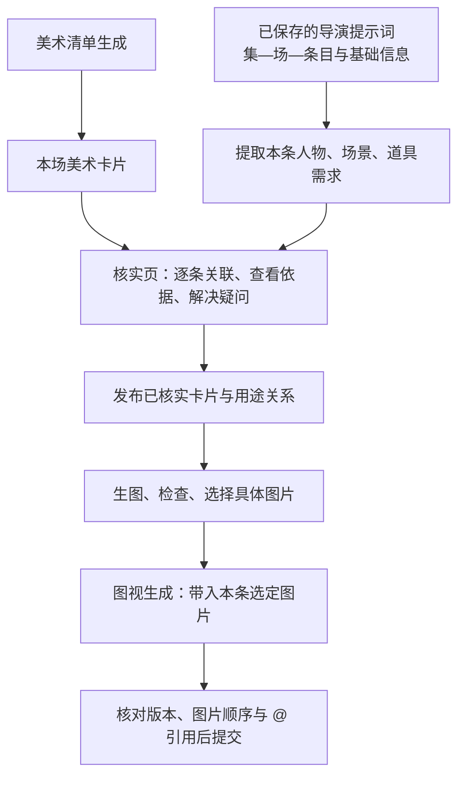

# 提示词与美术卡片提前关联：可选新模式设计

日期：2026-10-20

状态：本方案已获用户实施授权，首个直接项目载入版本已完成本机试用包；验收与未实施部分见 `docs/release-verification-2.8.54-private.1.md`。下文保留原设计范围。
代码基线：`125778d`，行舟影视 2.8.53。

## 1. 本次决定

把逐条素材关联提前到**美术清单生成后、清单核实过程中**。此时已有导演提示词就直接读取，按项目、集、场、条目建立“提示词需求 → 美术卡片”的关系；核实发布后连接正式资产，图片就绪后连接选定图片，视频提交时才编译具体 `@imageN`。

新增项目级可选模式“提示词联动美术（试用）”。保留现有“按场景整理素材”模式，旧项目不自动切换。新模式先独立于全自动生产流水线验收，后续自动化、半自动化共同读取这份关联记录。

用户已生成的导演提示词作为输入，不重新生成、不因建立关联而改写。美术卡片、视频提示词、图片是三种不同对象，分别保存、分别修订。

“本条不使用”只解除本条关系，不删除原卡片、图片或本场候选，也不影响同场其他条。

## 2. 当前实现能复用什么，缺什么

| 当前事实 | 源码位置 | 对新模式的含义 |
|---|---|---|
| 协作项目创建时已接收导演提示词的 id、label、content | `src/v06/CollabWorkspace.jsx:1585` | 不需要用户再导出文本、再导入以建立首次关系 |
| 本地导演源可通过既有 director-sync 同步 episodes；受 producer、锁定和分集校验约束 | `core/cloudTraffic.js:13`、`src/v06/CollabWorkspace.jsx:1530` | 已有读取与传递入口；新模式沿用权限，不把所有成员都当可写 |
| 美术核实页期间跳过一般自动刷新 | `src/v06/CollabWorkspace.jsx:1521`、`:1554` | 要显式呈现来源版本及“检查提示词更新”，不能假定此页始终拿到最新提示词 |
| 导演记录有独立提示词 id；自动分段还有 generationRunId、segmentationPlanId、segmentId | `core/directorCreative.js:130`、`core/directorQuickStore.js:140` | 能识别同场多次生成；不能单靠 1-1-1 文字编号认作同一版本 |
| 美术核实有逐场清单、人工锁定、发布快照；清单身份仍部分依赖类别和名字 | `core/artReview.js:9`、`:32`、`:228` | 保留核实机制，另建稳定卡片身份及明确的卡片到资产映射 |
| 发布美术通过项目内名称复用资产，冲突键是 project_id/name | `cloud-backend/src/art-review-repository.cjs:76` | 初期映射必须校验类别、版本与唯一性，不能把改显示名称等同于安全迁移 |
| 整本提示词导入会按编号重建条目身份，并把场/集素材作为默认挂载项 | `core/promptBook.js:3`、`:28` | 新模式要保留导演源条目身份，并以已确认集合初始化，不能仍默认挂满本场素材 |

因此当前不是完全没有项目同步，而是缺少可贯通各阶段的**逐条用途关系**。此前调查发现的导出导入身份丢失、人物与道具错配问题仍需一并处理，见[关联研究报告](2026-10-20-reference-binding-research.md)。

## 3. 用户流程



1. 在协作项目选择新模式，确认已关联的导演项目。系统展示已保存提示词覆盖到哪些集、场；无提示词的场仍可做美术，标记“等待提示词”。
2. 美术清单生成后，按本场逐条读取提示词的基础信息，优先做同类别、明确身份的匹配。AI 复核用途和状态，处理别名、代词、多人描述及歧义。
3. 核实页同时展示“本场有什么素材”和“每条用什么素材”。用户能从提示词看卡片，也能从卡片反查用途。
4. “核实并发布”保存本次确认的关系快照。场景美术核实通过与逐条关联通过分开记录；可先发布美术卡片，未解决的条目继续标待核对。
5. 生图仍按资产卡片进行。同一人物同一妆造跨四条使用，只生一套可复用图片，不按四条重复生图。出多张候选时明确选择，不能全部自动塞入视频。
6. 图视生成提供“从联动项目载入”入口，直接取已确认条目与图片。文件导出仍可用，但必须携带 manifest 保留关联。
7. 提交前检查最新版本、模型限制、必需图可用性和最终引用映射。已确认的新模式条目不再运行旧的全场模糊追加逻辑。

这两个前置工作仍可以并行。汇合以场或条目为单位，不要求全剧提示词先全部完成，更不要求等所有图片完成才保存关联。

## 4. 提前绑定两次，提交时编号一次

### 4.1 第一次：提示词关联美术卡片

示意记录：

```json
{
  "source": {
    "directorProjectId": "director-A",
    "promptId": "prompt-uuid",
    "label": "1-2-3",
    "promptHash": "content-hash",
    "sourceRevision": "snapshot-id"
  },
  "requirement": {
    "category": "prop",
    "text": "杯子",
    "evidence": "张三拿起杯子",
    "evidenceLocation": "本条基础信息及动作段",
    "visibility": "visible"
  },
  "selection": {
    "cardUid": "card-uuid",
    "assetId": null,
    "imageId": null,
    "status": "card_confirmed"
  }
}
```

这只是设计数据示意，不是现有接口。实际存储需包含账号、协作项目、集场身份、卡片版本、具体证据位置、人工锁定和决定来源，避免同名项目串联。

`cardUid` 新增为稳定身份，贯穿清单核实、发布和资产映射。已有核实条目的名称型 id 不能直接视为永久身份；试用阶段用独立映射记录，重命名、类别修改、合并或拆分都显式追踪。

### 4.2 第二次：卡片关联具体图片

发布卡片后解析到正式 `assetId`；图片生成并检查后选定 `imageId`、图片版本与内容哈希。

关系为多对多：一条提示词需要多张卡片，一张卡片服务多条提示词；同一卡片的多张图片是候选，最终按条目用途和模型支持决定选哪张。人物身份和人物妆造应区分，不能只绑定人物根节点就认为白衣、黑衣均正确。

正式资产尚未回传时保留 `card_confirmed`；有资产无图时为 `awaiting_image`。这两种状态都不等于可提交视频。

### 4.3 最后：按实际请求编译 @

在本条具体图片和顺序确定后生成 `@image1`、`@image2` 等模型引用。显示名称、卡片身份不依赖这些临时序号。

换图、删图、重排图片或换视频模型后重新编译并验证。原导演文本保留；用于提交的引用版本另存，已有手动 `@` 必须对照其原始图片映射迁移，不能盲目保留旧编号或字符串替换。

## 5. 基础信息应是主要依据，但要检查冲突

用户指出提示词已有明确基础信息，这能大幅减少重复理解。流程优先解析该结构，不要求 AI 重写导演内容。

- 按“人物／场景／道具”字段解析，支持实际存在的“基础设定／基础信息”等标题及多人格式；解析失败明确报待确认，不能默认为空需求。
- 人物字段只匹配人物，道具字段只匹配道具。“杯子｜张三常用”属于 prop；所有者、当前持有者分开记录。
- 提示词写“杯子”而本场有两只杯子，结合动作、上文及持有者判断；仍不确定保留疑问。
- 基础信息列出某人物但正文只有画外音，或正文出现基础信息未列的可见人物，标记冲突，AI 给依据和关联建议；不自动改写原文。
- 以整条视频提示词为范围。物件在本条后半段出现，仍属于本条需求；不能因第一镜没出现就排除。
- 区分实际入镜、仅提及、声音和必要环境参考。没有显式提及的环境参考可有用途，但必须说明，不能自动把全场资产都挂入。
- 资产在本场存在、解析未找到它时先修正关联；只有核实确实漏项时才回到美术补单，不默认重新生图。

AI 参与需求复核、歧义判断、关联修正和可用时的图片检查。程序负责身份、类别、版本、数量与实际请求的一致性。仍沿用用户已选的“限定次数内修正，仍不确定暂停该条”规则；人工锁定若有冲突则提请处理，不静默覆盖。

## 6. 核实页与美术卡片的展示

核实页新增“提示词关联”视图：左侧本场条目，右侧人物、场景、道具卡片；提示词原文只读查看。每张卡片展示“用于 1-2-1、1-2-3”，点开跳到条目与匹配依据。

状态文案：

| 状态 | 含义及可执行动作 |
|---|---|
| 等待提示词 | 本场可继续清单核实、生图；暂不能确认逐条用途 |
| 待核对 | 有歧义、结构解析问题或素材遗漏，显示具体原因 |
| 卡片已关联，待出图 | 用途已确认，可继续生成图片 |
| 待选图 | 有多个候选或图片检查未完成 |
| 可用于视频 | 当前条目、卡片与图片版本检查通过 |
| 来源已更新 | 保留旧确认记录，只重查受影响部分 |

提供“查看未使用的本场素材”，不默认删除它们。保留“本条不用”和“从场景移除”两个语义清楚的动作；后者会影响多条，应展示受影响条目。

虚构例子：

| 本场美术卡片 | 1-2-1 对话 | 1-2-2 拿杯子 | 1-2-3 递给李四 |
|---|---|---|---|
| 张三｜白衣 | 使用 | 使用 | 使用 |
| 李四｜常服 | 使用 | 本条不用 | 使用 |
| 杯子｜张三常用 | 本条不用 | 使用 | 使用，持有者变化 |
| 客厅｜日 | 环境参考 | 环境参考 | 环境参考 |

这里只关联用途，不会因第三条换了持有者就把杯子改成人物，也不会额外生成一张“李四的同一个杯子”。

## 7. 更新、并发与旧数据

| 变化 | 处理 |
|---|---|
| 提示词文字改了，id 未变 | 内容哈希变化，相关条目关联待复核，保留旧版和人工决定 |
| 同场重新生成一批，编号与旧批相同 | 按真实 promptId/批次区分，选择当前采用批次；不凭编号覆盖 |
| 重新分段，条数增减 | 建立新条目版本，旧条目退出当前计划，保留历史；不按数组下标迁移 |
| 只改展示编号、内容和身份不变 | 更新定位信息并校验新集场归属；原关系可保留 |
| 卡片改名 | 保持 cardUid/assetId 的显式映射，更新别名；不触发全库重命名 |
| 卡片合并、拆分、换类别或妆造 | 标记全部相关用途待复核，不能继承旧确认就直接提交 |
| 多生成一张图 | 只加入候选，不替换已选图，不改变已提交任务 |
| 用户选择新图 | 生成新的选择版本，仅使相关未提交条目预检失效 |
| AI 请求期间用户改了卡片或提示词 | 校验输入快照，旧结果作为历史候选，不覆盖最新确认 |
| 导演关联项目切换 | 原关系保留于原来源，新来源重新建立；同编号不继承 |
| 视频已经提交或成片已经完成 | 记录原提交快照，显示可另建新版本；不自动再次付费生成 |

核实页使用显式来源快照并提示更新。保存绑定前及视频提交前比较当前输入版本；离线无法确认云源最新状态时，标注当前冻结版本，按启动策略等待或使用明确冻结的版本，不能声称实时最新。

旧模式切换到新模式时先生成关联预览，保留人工已选、排除和手动绑定。未解决项不得偷偷回退成“按场全挂”。关闭新模式可恢复原工作入口；新模式的记录、图片和已提交任务保留。

## 8. 本机试用的实现边界

首轮采用独立试用构建/入口及独立关联存储，范围含账号、协作项目和导演来源。复用已有合法读取、清单发布与图片接口；新增用途关系先存本机，不把未经后端确认支持的任意字段塞进云记录并假定能持久化。

发布卡片后刷新正式资产，将该次发布快照与返回资产做显式映射。现阶段服务端按项目内名称复用，试用适配器只能在名称唯一、类别相符且输入版本未变时建立映射；冲突则阻断该映射。重命名时通过已保存身份迁移，不重新按新名字猜。

未来多机共享需专门的服务端用途关系、稳定卡片身份、权限及版本冲突处理；本机侧表不等于已实现云端协作。私人试用构建不更新公共 latest.json，也不对所有用户开放。

文件交换需同步导出提示词原始身份、文本哈希、卡片/资产/图片映射、选用与排除项、具体文件路径及哈希。仅有图片文件夹或纯文本的旧导入被标为旧模式/待补身份，不能冒充已确认的新模式结果。

## 9. 优先施工顺序与验收

本阶段先解决关联，不把视频队列、Topaz 和剪辑一并扩入首个试用包：

1. **来源与身份。** 导演提示词快照、当前批次、稳定卡片身份、发布映射与独立持久存储。
2. **清单核实中的用途关联。** 基础信息解析、AI 复核、逐条核对界面、人工锁定、局部更新。
3. **图片与图视生成贯通。** 确切选图、直接载入、带 manifest 导出导入、最终 @ 编译与请求预检。
4. **本机代表性场景试用。** 比较旧流程人工删选次数、错绑、多选、漏选、待核对比例及耗时；满意后接回自动化主线。

验收至少覆盖：

- 同场四条各用不同子集，未选图片不会进入 API 请求；从本条排除不删除公共素材。
- 五人物、同名多妆造、两只杯子、道具交接、画外音、同条后半段入镜。
- 生图前已有关联；一张图完成后正确服务多条，不重复付费生图。
- 只有部分场已生成提示词时可分场工作；无提示词不得标“关联完整”。
- 卡片发布前后身份贯通，重命名及类别调整不串绑；名称冲突可被识别。
- 同编号不同批次、重复导入、切项目、重分段、异步旧结果都不会覆盖已确认关系。
- 换图、重排、换模型后 `@` 和实际请求一致；必要图片超限时不静默删去。
- 重启后恢复关联，手动选择不丢；旧模式及旧项目原有操作仍可使用。
- 已提交任务绑定原输入快照；修正关系不自动重发付费视频。

这些是待实现的验收条件，当前没有新模式实测结果。此前已有的 10 个关联函数场景、1 个导出导入场景复现及 23 项原有测试属于现状证据，不能作为新模式已通过的证明。

## 10. 与总架构的关系

本方案优先于自动化主架构中的完整 Agent 运行器和剪辑闭环建设。先验证“已生成提示词 → 卡片 → 图片 → 正确视频请求”这条最小完整链，再由半自动接管已确认快照，由全自动按同一规则完成核实。

前置关联能减少后期依赖文件名重新判断的机会；最终图片内容、提示词自身矛盾以及视频模型是否遵循参考仍需检查。因此在真实样本验收前不宣称零错误或已经攻克全部生成质量问题。
